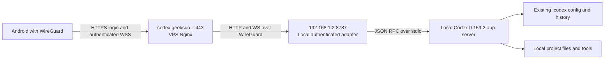

# Local Codex server through the existing WireGuard VPS

The app-server runs on `/home/nulltogeek`'s Linux machine. The VPS at `79.175.177.57` runs only the existing Nginx reverse proxy. The Android URL is **https://codex.geeksun.ir**. The desktop can be closed; the Linux machine, user service and WireGuard tunnel must remain available.

As of October 11, 2026, APK 0.7.1 and the deployed standalone server use **username/password login**. See [desktop-owned chat recovery](mobile-0.7.1.md), [favorites, swipe archive and password changes](mobile-0.7.0.md), [chat loading and composer improvements](mobile-0.6.0.md), [the current in-app update guide](in-app-updates.md) and [login guide](username-password-login.md); the older token-based verification below is historical.

The model-provider HTTP 401 was repaired later on October 11. Real replies and a follow-up now pass through the deployed HTTPS/WSS endpoint; see [the authentication repair](#provider-authentication-repaired-on-october-11-2026).



## Installed components and ownership

| Component | Location or setting | Purpose |
| --- | --- | --- |
| Backend | `/usr/lib/chatgpt/resources/codex`, version 0.159.2 | Public app-server over stdio |
| Codex home | `/home/nulltogeek/.codex` | Existing config, projects, history and host policy |
| Adapter | `bridge/standalone.mjs` in this repository | Authenticated HTTP snapshots and WebSocket RPC/events |
| User service | `~/.config/systemd/user/codex-remote.service` | Run independently of the desktop |
| Service drop-in | `~/.config/systemd/user/codex-remote.service.d/20-wireguard.conf` | Bind only to `192.168.1.2`; load private provider environment; retry startup every 10 seconds if the interface is late |
| Provider environment | `~/.config/custom-codex/provider.env`, mode 0600 | Supply the configured `EMZANO_AI_KEY` to systemd without putting it in process arguments |
| Login account | `~/.local/share/custom-codex/account.json`, mode 0600 | Salted scrypt password hash for the standalone server |
| Initial login reference | `~/.local/share/custom-codex/initial-login.json`, mode 0600 | View username/password locally with `vim`; never send in chat |
| VPS vhost | `/opt/reverse-proxy/conf.d/codex.geeksun.ir.conf` | Existing TLS/VPN ACL plus new upstream `http://192.168.1.2:8787` |
| Proxy process | Docker container `reverse-proxy`, host networking | Existing proxy; host Nginx service is inactive |
| Vhost backup | `/opt/reverse-proxy/backups/codex.geeksun.ir.conf.20261010T192016Z` | Recover the previous `.13:3000` upstream |

`config.toml` was not modified: a before/after SHA256 comparison passed. No Codex credentials, projects or history were copied to the VPS. No desktop files were patched or original desktop work interrupted. The damaged all-NUL pairing-token file was preserved as `pairing-token.corrupt-20261010`, then replaced with a valid token. Validation now rejects malformed token files.

The service is enabled and active. User lingering was already enabled. Boot, full logout and WireGuard outage recovery were not exercised; no machine or container was restarted. Nginx received a validated graceful reload.

Sharing the Codex home shares saved configuration/history. Standalone and ordinary desktop processes have separate live work and approvals. Connected Android/test clients share the standalone runtime. Use the optional desktop launcher only if you need one live runtime shared with the desktop, after finishing existing work.

## Connect the phone

1. Enable the phone's existing private WireGuard connection. It must reach the VPS private endpoint and use VPN DNS for `codex.geeksun.ir`. On the inspected Linux host, that name resolves to `10.42.42.1`.
2. Install `artifacts/codex-remote-release.apk` using Android's normal APK installer. Android 11 or newer is required. For an authorized USB device, `adb install -r artifacts/codex-remote-release.apk` installs or upgrades it while retaining application data.
3. Open the initial login reference with `vim ~/.local/share/custom-codex/initial-login.json`. Enter username `nulltogeek` and its password (or your new password after changing it in Settings) in the APK's sign-in fields, with server URL `https://codex.geeksun.ir`. Never put the password in a URL or chat message. The APK manages its authenticated `wss://codex.geeksun.ir/v1/rpc` session internally and stores the session encrypted with Android Keystore.

Nginx preserves the existing VPN-only access policy (`192.168.1.0/24` and the observed wg-easy masquerade source `10.42.42.42`). It forwards WebSocket upgrades with buffering disabled and a one-hour read timeout. Public non-VPN access was tested and returned 403. Backend inventory/RPC also requires a session issued by username/password login. The TLS certificate was verified without disabling validation; the existing wildcard certificate expires December 18, 2026. Certificate renewal remains the existing proxy administrator's responsibility.

## Checks and recovery

Start with one inspection and examine its output before changing anything:

```bash
systemctl --user show codex-remote.service -p ActiveState -p SubState -p MainPID
```

This checks the standalone service without affecting desktop work. If it is running, check the WireGuard listener:

```bash
curl --noproxy '*' --fail --max-time 10 http://192.168.1.2:8787/healthz
```

Then check the private proxy path:

```bash
curl --noproxy '*' --fail --max-time 10 https://codex.geeksun.ir/healthz
```

Health exposes only `{"ok":true}`. For authenticated metadata, inventory, two-client RPC/events and replay checks, run from this repository:

```bash
node scripts/verify-server.mjs https://codex.geeksun.ir --local-inventory
```

The verifier reads the owner-only initial login reference directly, signs in and revokes its test session afterward; it does not put credentials in arguments or print provider error bodies. It creates an ephemeral verification chat, leaving saved history unchanged.

If the provider rejects generation, inspect its authentication separately from app login. The earlier environment credential expired at `2026-10-06T09:16:09Z`, causing HTTP 401 until the October 11 repair. Renew it through the provider's normal authentication flow and edit the private environment file using `vim ~/.config/custom-codex/provider.env`, preserving the `EMZANO_AI_KEY="..."` assignment and mode 0600. Preserve an owner-only backup before changing the file. Do not paste the value into chat or put it in this repository. This service reads its own environment file; updating a terminal variable or the desktop's environment does not update a running service. The Codex `model_providers.<id>.env_key` setting names the variable to supply; see the [official configuration reference](https://developers.openai.com/codex/config-reference/).

After saving a renewed credential and confirming the standalone server has no work to preserve, restarting **only this service** loads the new value:

```bash
systemctl --user restart codex-remote.service
```

Restart only after confirming there are no active turns or pending approvals; it ends the server's live runtime and changes the replay epoch. It also invalidates app sessions, requiring a fresh sign-in. The ordinary desktop runtime is separate. Android refreshes authoritative state after reconnect and never automatically resends uncertain prompts. Verify generation and a follow-up with:

```bash
node scripts/verify-server.mjs https://codex.geeksun.ir --local-inventory --model
```

If proxy health fails but local health works, inspect only the Codex vhost on the VPS. Use the authorized SSH identity `~/.ssh/emzano`. Validate with `docker exec reverse-proxy nginx -t` before any graceful `docker exec reverse-proxy nginx -s reload`. Do not restart unrelated containers or the inactive host Nginx service. Compare the saved vhost backup before making a recovery edit with `vim`; restoring the old upstream points back to the earlier service, not this app-server.

## Verified on October 10, 2026

- `npm run check`: backend syntax passed; verifier separately passed `node --check`.
- `npm test`: **23 passed**, including initialization, request-ID collisions, approval arbitration, unavailable desktop tools, replay gaps, backend epochs, bind restrictions and corrupt-token rejection. Evidence: `artifacts/standalone-unit-tests.txt`.
- `npm run test:standalone`: bundled backend initialized without a desktop driver; effective configuration includes the existing config file; both clients see one runtime; disconnect leaves it running; complete persisted inventory matches. Evidence: `artifacts/standalone-live-verification.txt`.
- `node scripts/verify-server.mjs https://codex.geeksun.ir --local-inventory`: **passed**, normal TLS verification, valid bearer accepted, missing/invalid bearer and browser Origins rejected, unauthorized/browser WebSockets rejected, **8 models, 15 projects, 32 active + 96 archived chats**, matching the local catalogue; two-client events and reconnect succeeded. Evidence: `artifacts/proxied-server-verification.json`.
- VPS reached `192.168.1.2:8787/healthz`; container Nginx validation passed; private proxy health returned 200 and public non-VPN health returned 403.
- Real model generation failed with provider HTTP 401; neither generation nor a successful follow-up/real model approval is accepted yet. Evidence: `artifacts/local-server-verification.json`.
- Existing release APK ZIP integrity, Android signature and checksum passed. Current SHA256: `2fc00aede1a7b581a25d0da7da00018aee80dc8c855a1085bbc291f241ca6ce1`. It matches the repository's existing checksum manifest and release build output. No Android code change or rebuild was required for this URL deployment. The signing certificate is the local development certificate, suitable for personal sideloading.

Physical phone WireGuard/DNS access, phone lifecycle in this deployment, reboot recovery, real approvals and release streaming performance remain unverified. The earlier software-emulator benchmark measured 643 frames and 0% within the display budget, so the 95% performance target remains unmet. Historical Android build and instrumentation evidence is in [verification](verification.md).

## Reverified on October 11, 2026

The existing deployment was inspected after the earlier chat was interrupted. No service, Nginx, WireGuard, DNS or credential configuration was changed, and no service or container was restarted.

- `systemctl --user show codex-remote.service -p LoadState -p ActiveState -p SubState -p MainPID -p UnitFileState -p FragmentPath`: loaded, enabled, active and running.
- `ip -brief address` and `ss -ltnp '( sport = :8787 )'`: `wg0` owns `192.168.1.2`; the adapter listens on `192.168.1.2:8787`.
- SSH inspection of `/opt/reverse-proxy/conf.d/codex.geeksun.ir.conf` confirmed the existing VPN ACL, HTTPS termination and WebSocket forwarding to `http://192.168.1.2:8787`. `docker exec reverse-proxy nginx -t` passed. The VPS's `curl --noproxy '*' --fail --silent --show-error --max-time 10 http://192.168.1.2:8787/healthz` returned `{"ok":true}`.
- `getent ahostsv4 codex.geeksun.ir` resolved to `10.42.42.1`; `curl --noproxy '*' --fail --silent --show-error --max-time 15 https://codex.geeksun.ir/healthz` returned HTTP 200 with ordinary certificate validation.
- `node scripts/verify-server.mjs https://codex.geeksun.ir --local-inventory` passed: valid pairing accepted; missing/invalid pairing and browser Origins rejected; unauthorized/browser WebSockets rejected; 8 models, 15 projects, 33 active chats and 96 archived chats matched local inventory; two clients shared events; disconnect/reconnect passed.
- `node scripts/verify-server.mjs https://codex.geeksun.ir --local-inventory --model` failed at generation with provider HTTP 401. Renewed provider authentication remains required before successful model replies and follow-ups can be accepted.
- `systemctl --user show codex-remote.service -p EnvironmentFiles` confirmed that the running service is configured to load `~/.config/custom-codex/provider.env`. File metadata checks confirmed that this file and the pairing token have mode 0600, and that `artifacts/codex-remote-release.apk` exists. Credential values were not printed.

The phone still requires the existing WireGuard connection and VPN DNS. Physical phone access, reboot/logout recovery, real approvals and streaming performance were not tested in this verification. Public access was not retested; the existing VPN-only Nginx policy remains configured.

## Provider authentication repaired on October 11, 2026

The phone's message reached the standalone server, but `https://codex.lmngtechteam.com/backend-api/codex/responses` rejected its model credential with HTTP 401. The selected provider is `emzano-ai`, model `gpt-6.1-sol`, with `env_key = "EMZANO_AI_KEY"`. The service and its backend inherited the expired value from the private environment file, while the desktop backend had a different, working credential. App username/password authentication was already working.

A harmless provider request using the desktop credential returned HTTP 200 and the expected reply. Before changing the service, an authenticated inspection found zero active turns and zero pending approvals (one idle chat and one `systemError` chat). The private environment file was backed up as `~/.config/custom-codex/provider.env.backup-20261011T090358Z`, then updated with the verified credential while retaining mode 0600. Only `codex-remote.service` was restarted. Configuration/model selection, Nginx and the APK were unchanged. Credential values were not printed or added to the repository.

Exact post-restart verification:

```bash
node scripts/verify-server.mjs https://codex.geeksun.ir --local-inventory --model
```

The command passed with ordinary TLS validation: username/password login, rejection of unauthorized HTTP/WebSocket requests and browser Origins, eight models, 15 projects, and all 36 active catalogue entries plus 96 archived entries matching the local inventory. Real model streaming completed with the expected reply; a follow-up from the second client completed in the same chat without duplicate turns. Shared events, disconnect/reconnect and sign-out revocation also passed.

Sign in again on the phone after the restart and manually resend the failed message. No APK update is required for this repair. The physical-phone retry, actual model-triggered approvals, reboot/logout recovery and hardware performance remain unverified. This verification used text only; image understanding was not retested.

## Rebuild

Use Node.js 22.13+ and `npm ci` for the adapter. JDK 17 and Android SDK 35 are required for `./scripts/build-android.sh`; that script runs JVM tests, lint and debug/release assembly. See the root README for SDK installation and the optional build download proxy `localhost:8080`. The proxy is for downloads only and is unrelated to the runtime WireGuard path.
