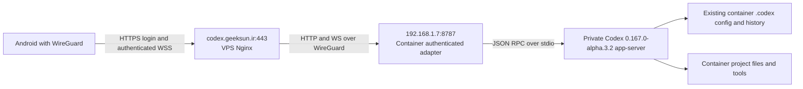

# Container Codex server through the existing WireGuard VPS

As of November 10, 2026, the standalone app-server runs inside the systemd desktop container at **192.168.1.7** on `emz-ops-work1`. Its project is `/home/nulltogeek/Desktop/nulltogeek/custom-codex`. The VPS at `79.175.177.57` runs the existing Nginx proxy; the Android URL remains **https://codex.geeksun.ir**. GNOME and the desktop app can be closed. The container, user service and WireGuard tunnel must remain available.

The original local `codex-remote.service` is disabled and stopped; source files remain for recovery. The container retains its own existing `.codex` configuration and history. The prepared filmapp chat queue was not imported, and no recurring sync was installed.



## Installed components and persistence

| Component | Container location or setting | Purpose |
| --- | --- | --- |
| Backend | `~/.local/lib/custom-codex/runtime/bin/codex`, version 0.167.0-alpha.3.2, plus its sibling `codex-code-mode-host` | Durable app-server independent of desktop package changes |
| Node | `~/.local/lib/custom-codex/runtime/bin/node`, version 22.23.2 | Official Linux binary, verified against its SHA256 manifest; no global Node/npm installation |
| Codex home | `/home/nulltogeek/.codex` | Existing target configuration, projects, history and policy |
| Adapter | `/home/nulltogeek/Desktop/nulltogeek/custom-codex/bridge/standalone.mjs` | Authenticated HTTP and WebSocket RPC/events |
| User service | `~/.config/systemd/user/codex-remote.service` | Enabled under real systemd; user lingering is enabled |
| VPN readiness | `~/.local/lib/custom-codex/wait-vpn.py` | Wait for the VPN address before startup; bind only to `192.168.1.7:8787`; retry after failure |
| Provider environment | `~/.config/custom-codex/provider.env`, mode 0600 | Supply `EMZANO_AI_KEY` without exposing it in arguments |
| Account and uploads | `~/.local/share/custom-codex/account.json` and `uploads/` | Original current password hash and 22 source upload files preserved |
| APK updates | Project `artifacts/updates/` | Exact release/debug 0.7.24 manifests and referenced APKs |
| VPS vhost | `/opt/reverse-proxy/conf.d/codex.geeksun.ir.conf` | Existing TLS, VPN ACL and WebSocket settings; upstream and Host are `192.168.1.7:8787` |
| Vhost backup | `/opt/reverse-proxy/backups/codex.geeksun.ir.conf.20261110T125727Z-before-192.168.1.7` | Previous `.2:8787` configuration |

Application files, private runtimes, credentials and uploads live in the persistent developer home volume. The migration did not replace `config.toml` or saved target chats. Standalone and desktop processes share saved configuration/history but own separate live turns and approvals.

The transferred local service credential was stale. A credential from the working local Codex backend was verified with a minimal no-tools streaming request on both machines, then installed only in the target service's private environment file. The transferred credential remains privately backed up. No credential values were added to this repository or logs.

## Connect the phone

1. Enable the phone's existing WireGuard connection and VPN DNS for `codex.geeksun.ir`.
2. Keep the same server URL, **https://codex.geeksun.ir**. No APK rebuild or URL change is required; current update assets are 0.7.24.
3. Sign in again as `nulltogeek` using your current app password. Migration invalidated in-memory sessions while preserving the existing password hash. The old `initial-login.json` reference is obsolete; it was not copied or used to reset your password.

Nginx retains its VPN-only access policy, TLS validation, 21 MB request limit and WebSocket forwarding. Physical-phone sign-in after migration remains to be checked from the phone.

## Checks and recovery

Connect to the container first, then inspect one result before proceeding:

```bash
ssh -i ~/.ssh/emzano -o IdentitiesOnly=yes nulltogeek@192.168.1.7
```

Inspect the user service without interrupting it:

```bash
systemctl --user show codex-remote.service -p ActiveState -p SubState -p MainPID
```

Check its VPN listener, then the normal TLS proxy path:

```bash
curl --noproxy '*' --fail --max-time 10 http://192.168.1.7:8787/healthz
```

```bash
curl --noproxy '*' --fail --max-time 10 https://codex.geeksun.ir/healthz
```

Health returns only `{"ok":true}`; protected HTTP and WebSocket endpoints require authentication. For a full check, provide the current username/password in an owner-only JSON file outside the repository, then set `CODEX_INITIAL_LOGIN_FILE` to that file when invoking the verifier with the private runtime. Do not use the stale initial-login reference or put passwords in arguments.

```bash
CODEX_INITIAL_LOGIN_FILE=/run/user/1000/custom-codex-verification-login.json \
  ~/.local/lib/custom-codex/runtime/bin/node scripts/verify-server.mjs https://codex.geeksun.ir --local-inventory --model
```

The verifier creates an ephemeral chat and omits provider error bodies. If generation fails, inspect provider authentication separately from app login. Preserve an owner-only backup, edit `~/.config/custom-codex/provider.env` using `vim`, and retain mode 0600. A renewed environment file is loaded only after restarting this user service. Confirm no active turns or pending approvals before a restart, which ends its live runtime and requires app sign-in again.

```bash
systemctl --user restart codex-remote.service
```

If proxy health fails while direct target health works, inspect only the Codex vhost using `ssh -i ~/.ssh/emzano -o IdentitiesOnly=yes root@79.175.177.57`. Run `docker exec reverse-proxy nginx -t` before a graceful `docker exec reverse-proxy nginx -s reload`.

For rollback, first restore a verified provider environment for the original local service: its original environment file was stale. Private verified credential backups and migration receipts are retained in the migration staging directories. Start/enable the local service, verify `.2:8787`, restore the saved vhost, validate/reload Nginx, then stop the target service. Restoring the proxy alone is insufficient because the local service is disabled.

## Verified on November 10, 2026

- Staged source bridge tests: **60 passed**. Private Node version, SQLite and CLI smoke checks passed; official Node archive SHA256 was verified.
- Isolated target runtime with separate test account/uploads: valid and invalid login, HTTP/WS access checks, exact target inventory (**9 models, 4 projects, 251 active and 4 archived chats**), mirrored events, model streaming, cross-client follow-up, reconnect and sign-out revocation all passed.
- Both exact 0.7.24 APKs were downloaded through authenticated endpoints, with byte count/SHA256 verification; synthetic text, image and 2 MB binary uploads passed.
- Production user service startup and restart passed, lingering is enabled, and the listener is restricted to `.7:8787`. The source account hash and all 22 upload files matched immediately before cutover.
- VPS reached the target directly. Nginx validation and graceful reload passed. Normal TLS domain health returned 200, protected HTTP and unauthorized WSS returned 401, and domain health remained good after the local service stopped.

Real-account phone sign-in, a full container reboot after this application installation, and real interactive approvals remain unverified. The exact same application and current account hash are deployed; valid login/model tests used an isolated test account rather than resetting the real password. Historical checks below describe earlier deployments.

## Verified on October 10, 2026

- `npm run check`: backend syntax passed; verifier separately passed `node --check`.
- `npm test`: **23 passed**, including initialization, request-ID collisions, approval arbitration, unavailable desktop tools, replay gaps, backend epochs, bind restrictions and corrupt-token rejection. Evidence: `artifacts/standalone-unit-tests.txt`.
- `npm run test:standalone`: bundled backend initialized without a desktop driver; effective configuration includes the existing config file; both clients see one runtime; disconnect leaves it running; complete persisted inventory matches. Evidence: `artifacts/standalone-live-verification.txt`.
- `node scripts/verify-server.mjs https://codex.geeksun.ir --local-inventory`: **passed**, normal TLS verification, valid bearer accepted, missing/invalid bearer and browser Origins rejected, unauthorized/browser WebSockets rejected, **8 models, 15 projects, 32 active + 96 archived chats**, matching the local catalogue; two-client events and reconnect succeeded. Evidence: `artifacts/proxied-server-verification.json`.
- VPS reached `192.168.1.2:8787/healthz`; container Nginx validation passed; private proxy health returned 200 and public non-VPN health returned 403.
- Real model generation failed with provider HTTP 401; neither generation nor a successful follow-up/real model approval is accepted yet. Evidence: `artifacts/local-server-verification.json`.
- Existing release APK ZIP integrity, Android signature and checksum passed. Current SHA256: `2fc00aede1a7b581a25d0da7da00018aee80dc8c855a1085bbc291f241ca6ce1`. It matches the repository's existing checksum manifest and release build output. No Android code change or rebuild was required for this URL deployment. The signing certificate is the local development certificate, suitable for personal sideloading.

Physical phone WireGuard/DNS access, phone lifecycle in this deployment, reboot recovery, real approvals and release streaming performance remain unverified. The earlier software-emulator benchmark measured 643 frames and 0% within the display budget, so the 95% performance target remains unmet. Historical Android build and instrumentation evidence is in [verification](verification.md).

## Reverified on October 11, 2026

The existing deployment was inspected after the earlier chat was interrupted. No service, Nginx, WireGuard, DNS or credential configuration was changed, and no service or container was restarted.

- `systemctl --user show codex-remote.service -p LoadState -p ActiveState -p SubState -p MainPID -p UnitFileState -p FragmentPath`: loaded, enabled, active and running.
- `ip -brief address` and `ss -ltnp '( sport = :8787 )'`: `wg0` owns `192.168.1.2`; the adapter listens on `192.168.1.2:8787`.
- SSH inspection of `/opt/reverse-proxy/conf.d/codex.geeksun.ir.conf` confirmed the existing VPN ACL, HTTPS termination and WebSocket forwarding to `http://192.168.1.2:8787`. `docker exec reverse-proxy nginx -t` passed. The VPS's `curl --noproxy '*' --fail --silent --show-error --max-time 10 http://192.168.1.2:8787/healthz` returned `{"ok":true}`.
- `getent ahostsv4 codex.geeksun.ir` resolved to `10.42.42.1`; `curl --noproxy '*' --fail --silent --show-error --max-time 15 https://codex.geeksun.ir/healthz` returned HTTP 200 with ordinary certificate validation.
- `node scripts/verify-server.mjs https://codex.geeksun.ir --local-inventory` passed: valid pairing accepted; missing/invalid pairing and browser Origins rejected; unauthorized/browser WebSockets rejected; 8 models, 15 projects, 33 active chats and 96 archived chats matched local inventory; two clients shared events; disconnect/reconnect passed.
- `node scripts/verify-server.mjs https://codex.geeksun.ir --local-inventory --model` failed at generation with provider HTTP 401. Renewed provider authentication remains required before successful model replies and follow-ups can be accepted.
- `systemctl --user show codex-remote.service -p EnvironmentFiles` confirmed that the running service is configured to load `~/.config/custom-codex/provider.env`. File metadata checks confirmed that this file and the pairing token have mode 0600, and that `artifacts/codex-remote-release.apk` exists. Credential values were not printed.

The phone still requires the existing WireGuard connection and VPN DNS. Physical phone access, reboot/logout recovery, real approvals and streaming performance were not tested in this verification. Public access was not retested; the existing VPN-only Nginx policy remains configured.

## Provider authentication repaired on October 11, 2026

The phone's message reached the standalone server, but `https://codex.lmngtechteam.com/backend-api/codex/responses` rejected its model credential with HTTP 401. The selected provider is `emzano-ai`, model `gpt-6.1-sol`, with `env_key = "EMZANO_AI_KEY"`. The service and its backend inherited the expired value from the private environment file, while the desktop backend had a different, working credential. App username/password authentication was already working.

A harmless provider request using the desktop credential returned HTTP 200 and the expected reply. Before changing the service, an authenticated inspection found zero active turns and zero pending approvals (one idle chat and one `systemError` chat). The private environment file was backed up as `~/.config/custom-codex/provider.env.backup-20261011T090358Z`, then updated with the verified credential while retaining mode 0600. Only `codex-remote.service` was restarted. Configuration/model selection, Nginx and the APK were unchanged. Credential values were not printed or added to the repository.

Exact post-restart verification:

```bash
node scripts/verify-server.mjs https://codex.geeksun.ir --local-inventory --model
```

The command passed with ordinary TLS validation: username/password login, rejection of unauthorized HTTP/WebSocket requests and browser Origins, eight models, 15 projects, and all 36 active catalogue entries plus 96 archived entries matching the local inventory. Real model streaming completed with the expected reply; a follow-up from the second client completed in the same chat without duplicate turns. Shared events, disconnect/reconnect and sign-out revocation also passed.

Sign in again on the phone after the restart and manually resend the failed message. No APK update is required for this repair. The physical-phone retry, actual model-triggered approvals, reboot/logout recovery and hardware performance remain unverified. This verification used text only; image understanding was not retested.

## Rebuild

Use Node.js 22.13+ and `npm ci` for the adapter. JDK 17 and Android SDK 35 are required for `./scripts/build-android.sh`; that script runs JVM tests, lint and debug/release assembly. See the root README for SDK installation and the optional build download proxy `localhost:8080`. The proxy is for downloads only and is unrelated to the runtime WireGuard path.
